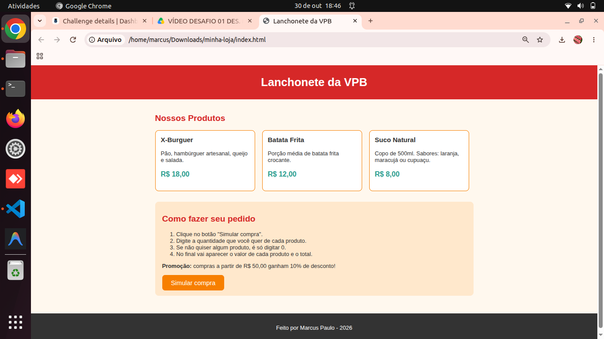

# Lanchonete da VPB — Simulador de Compras

**Aluno:** Marcus Paulo
**Trilha:** Trilhas Inova 3
**Desafio:** Desafio 1 — Minha Loja: Simulador de Compras

---

## Sobre a loja

A **Lanchonete da VPB** é uma lanchonete fictícia em homenagem ao bairro que moro e essa lanchonete vende lanches caseiros, feitos na hora. Eu escolhi esse tema porque gosto de lanche e achei que seria fácil de pensar nos produtos e preços.

Na página dá pra ver os produtos e clicar no botão **"Simular compra"**. O JavaScript pergunta quantos de cada produto a pessoa quer, calcula tudo e mostra o resultado num alerta.

### Produtos e preços

| Produto | Descrição | Preço |
|---|---|---|
| X-Burguer | Pão, hambúrguer artesanal, queijo e salada | R$ 18,00 |
| Batata Frita | Porção média de batata frita crocante | R$ 12,00 |
| Suco Natural | Copo de 500ml (laranja, maracujá ou cupuaçu) | R$ 8,00 |

### Promoção (desconto)

Se o valor da compra for **R$ 50,00 ou mais**, o cliente ganha **10% de desconto**.

---

## Tecnologias usadas

- **HTML** — pra montar a estrutura da página
- **CSS** — pra deixar a página bonita (cores, caixinhas dos produtos, botão)
- **JavaScript** — pra fazer a simulação da compra (`prompt()`, `Number()`, `alert()`, `if`)

## Arquivos do projeto

```
minha-loja/
├── index.html      → a página da loja
├── style.css       → o estilo da página
├── script.js       → a função que simula a compra
├── README.md       → este arquivo
└── assets/
    └── image.png
```

## Como executar

1. Baixe ou clone este repositório.
2. Abra a pasta do projeto.
3. Dê dois cliques no arquivo `index.html` (ele abre no navegador).
4. Clique no botão **"Simular compra"** e digite as quantidades.

Não precisa instalar nada, só ter um navegador (Chrome, Edge, Firefox...).

---

## Captura de tela



